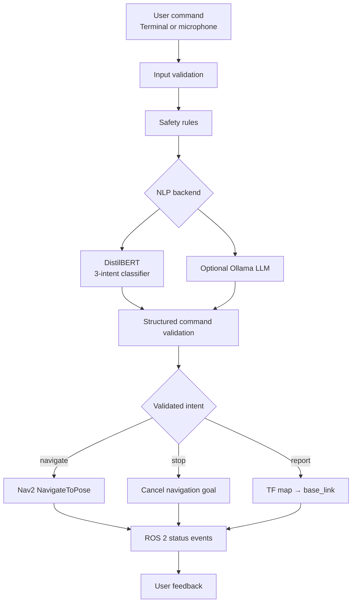
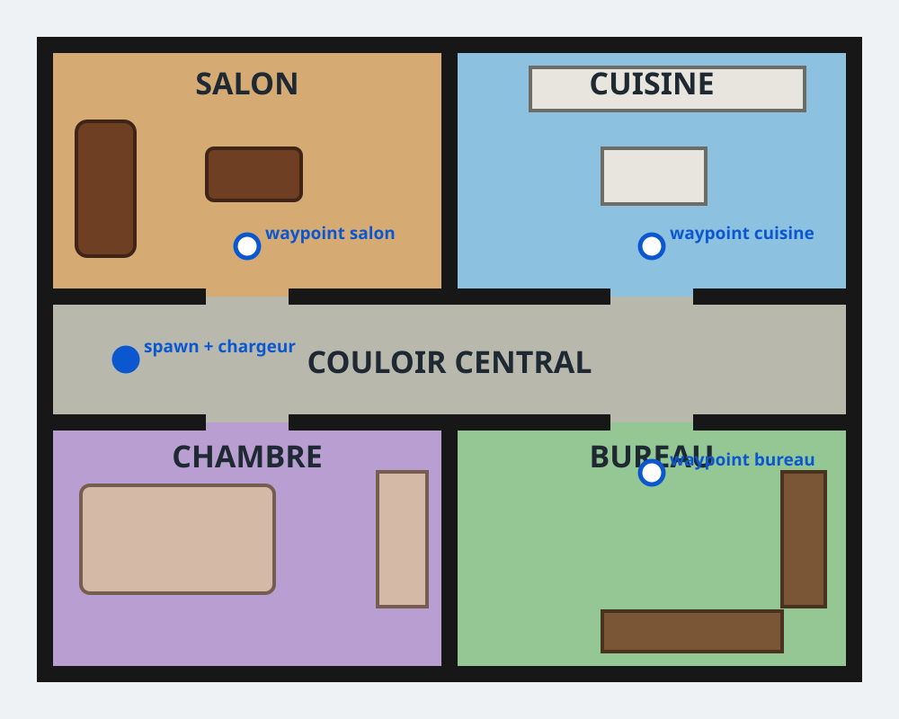

# 🤖 NLP Robot Commander
### Intelligent Natural Language Interface for Autonomous Mobile Robots

<p align="center">
  <strong>HESTIM Engineering Project · Big Data & Artificial Intelligence</strong>
</p>

<p align="center">
  
  
  
  
  
  
  
</p>

**NLP Robot Commander** is an intelligent natural-language interface designed to control a TurtleBot3 mobile robot through French commands.

The project combines a fine-tuned DistilBERT intent classifier, a safety-oriented command-processing pipeline, ROS 2 communication, and Nav2 navigation actions. An optional local LLM backend adds contextual command handling and a lightweight SQLite conversation memory.

The objective is to transform human language into validated robot actions while maintaining explicit safety constraints and traceable execution states.

---

## ✨ Key Features

| Feature | Description |
|---|---|
| Natural Language Understanding | Recognizes French commands using a fine-tuned DistilBERT model |
| Intent Classification | Supports `navigate`, `stop`, and `report` |
| Entity Extraction | Identifies authorized robot destinations |
| Safety Validation | Rejects ambiguous, denied, oversized, and out-of-domain commands |
| Autonomous Navigation | Sends validated navigation goals to Nav2 |
| Emergency Stop | Requests cancellation of active navigation goals |
| Robot Status | Retrieves robot position through TF |
| Optional Local LLM | Uses Ollama for contextual command interpretation |
| Conversation Memory | Stores accepted commands in SQLite |
| ROS 2 Integration | Connects the NLP pipeline to a ROS 2 robot architecture |
| Simulation | Uses Gazebo and Nav2 for the TurtleBot3 environment |

## 🧠 Supported Commands

The system recognizes three primary intents:

| Intent | Example | Expected behavior |
|---|---|---|
| `navigate` | « Rends-toi dans la cuisine » | Sends a `NavigateToPose` goal to an authorized waypoint |
| `stop` | « Arrête-toi immédiatement » | Requests navigation cancellation and waits for the result |
| `report` | « Où te trouves-tu ? » | Reads a recent `map → base_link` TF transformation |

Commands are validated before being routed to ROS 2.

Unknown destinations, ambiguous instructions, negated commands, and invalid inputs are rejected.

An explicit, non-negated stop instruction receives priority over other words in the command.

---

## 🏗️ System Architecture

The architecture separates language understanding, safety validation, decision-making, and robot execution.



### Processing Pipeline

1. **Input:** receive a natural-language command.
2. **Validation:** check command length, structure, and safety conditions.
3. **Intent recognition:** classify the command.
4. **Entity extraction:** identify the requested destination when applicable.
5. **Decision validation:** verify that the action is permitted.
6. **ROS 2 execution:** route the validated command to the corresponding subsystem.
7. **Feedback:** publish structured status events.

### Safety-first design

The NLP model does not directly control the robot.

Every predicted command passes through a deterministic validation layer. Navigation is restricted to an explicit waypoint whitelist, while stop requests follow a dedicated cancellation workflow.

The optional LLM backend also has no direct access to ROS 2. It produces structured output that is independently validated before execution.

---

## 📊 Model Evaluation

The following measurements were obtained on October 22, 2026, using random seed 42.

| Evaluation | Samples | Accuracy | Macro F1 |
|---|---:|---:|---:|
| Fixed validation set | 36 | 97.22% | 97.22% |
| Independent test set | 45 | 100.00% | 100.00% |
| Safety / adversarial evaluation | 15 | 100.00% expected decisions | — |

### Evaluation methodology

- The validation set contains 36 samples.
- The independent test set contains 45 samples, with 15 examples per intent.
- The safety campaign contains 15 adversarial or safety-oriented scenarios.
- The selected DistilBERT checkpoint was obtained from a 12-epoch training campaign.

**Important:** these results measure the NLP classifier and local decision pipeline. They do not demonstrate successful physical or simulated robot navigation. Gazebo, Nav2, TF, and stop behavior require separate end-to-end validation.

### Reproduce the experiments

```bash
python scripts/train_intent_classifier.py \
  --output-dir models/distilbert-robot-commander-3intents \
  --artifacts-dir artifacts/training_3intents \
  --epochs 12 \
  --batch-size 8 \
  --seed 42

python scripts/evaluate_intent_classifier.py \
  --model models/distilbert-robot-commander-3intents \
  --output-dir artifacts/test_campaign_3intents

python scripts/evaluate_safety_commands.py \
  --model models/distilbert-robot-commander-3intents \
  --output-dir artifacts/safety_campaign_transformers
```

---

## 🧰 Technology Stack

| Category | Technologies |
|---|---|
| Programming | Python |
| NLP | Hugging Face Transformers, DistilBERT |
| Machine Learning | PyTorch, scikit-learn |
| Local LLM | Ollama |
| Memory | SQLite |
| Robotics Middleware | ROS 2 Humble |
| Navigation | Nav2 |
| Robot Simulation | Gazebo, TurtleBot3 |
| Visualization | RViz2 |
| Testing | pytest |
| Development Environment | Ubuntu, WSL 2, Docker |

---

## 🚀 Development Environment

### Current Windows / WSL setup

The current development environment is:

| Component | Current status |
|---|---|
| Host OS | Windows |
| Linux environment | Ubuntu 24.04.4 LTS |
| WSL | WSL 2 |
| Linux kernel | Microsoft WSL2 kernel |
| Git | Installed |
| Docker Desktop integration | Pending verification |
| ROS 2 Humble simulation | Not yet validated in this environment |

The WSL distribution is already installed and running. Docker Desktop integration must be enabled for Ubuntu before using the `docker` command from WSL.

### Recommended ROS 2 runtime

ROS 2 Humble targets Ubuntu 22.04 as its primary platform. The current Ubuntu 24.04 WSL distribution should not be treated as a native Humble installation environment without an explicitly compatible setup.

For reproducibility, use a ROS 2 Humble-compatible Linux environment, such as a Docker container based on the official ROS Humble image.

Official references:

- [ROS 2 Humble](https://docs.ros.org/en/humble/)
- [Docker Desktop with WSL 2](https://docs.docker.com/desktop/features/wsl/)
- [Ubuntu on WSL](https://learn.microsoft.com/en-us/windows/wsl/)

---

## 📦 Installation and Project Setup

### 1. Clone the repository

Inside Ubuntu WSL:

```bash
mkdir -p ~/projects
cd ~/projects

git clone https://github.com/yayaSB/NLP-Robot-Commander.git

cd NLP-Robot-Commander
```

Keep the project inside the Linux filesystem (`~/projects`) rather than `/mnt/c` for better Linux development and build performance.

### 2. Configure Docker Desktop

On Windows:

1. Open Docker Desktop.
2. Navigate to **Settings → Resources → WSL Integration**.
3. Enable integration for Ubuntu.
4. Apply changes and restart Docker Desktop.

Verify from Ubuntu:

```bash
docker --version
docker info
docker ps
```

### 3. Prepare the ROS environment

Use a ROS Humble-compatible environment for the ROS workspace and simulation.

The project includes setup scripts:

```bash
bash scripts/wsl_setup.sh
```

The bootstrap script is intended to prepare the NLP and ROS development environment, create the Python environment, build the workspace, run tests, and configure Ollama.

Check the actual prerequisites and supported Ubuntu version in:

[`docs/HOW_TO_FIRST_RUN_ON_VSCODE.md`](docs/HOW_TO_FIRST_RUN_ON_VSCODE.md)

Verify the environment:

```bash
bash scripts/wsl_check.sh
```

### 4. Restore the model checkpoint

The `models/` directory is not versioned in Git because the DistilBERT checkpoint is larger than GitHub's standard file-size limit.

Train the model locally using the training command above, or transfer the existing checkpoint through an appropriate model-storage mechanism.

Expected model directory:

```text
models/
└── distilbert-robot-commander-3intents/
```

---

## 🧪 Local NLP Demo

After preparing the Python environment and restoring the checkpoint:

```bash
bash scripts/wsl_run_demo.sh --clear-memory
```

This runs the local NLP demonstration without requiring a successful Gazebo navigation session.

---

## 🧠 Optional LLM Backend and Memory

The project includes an optional local LLM integration using Ollama.

The LLM is used for structured command interpretation and contextual interactions. It does not receive direct access to ROS 2.

### Install the model

```bash
ollama pull llama3.2:1b
```

Start Ollama if its service is not already running:

```bash
ollama serve
```

Run the demo:

```bash
bash scripts/wsl_run_demo.sh
```

Example interaction:

```text
Va dans la cuisine
Refais la dernière commande
```

The memory subsystem uses SQLite to store up to 200 accepted commands and provides the eight most recent commands as context.

Explicit history references can be resolved directly through SQLite to improve reliability with a small local LLM.

To clear the history:

```bash
bash scripts/wsl_run_demo.sh --clear-memory
```

The database is local and is not versioned by Git.

---

## 🤖 ROS 2 Simulation

The simulation integrates:

- TurtleBot3
- Gazebo
- ROS 2 Humble
- Nav2
- AMCL localization
- TF transformations
- Project-specific apartment map and waypoints

### Build the workspace

```bash
bash scripts/wsl_build.sh
```

### Start the simulation

```bash
bash scripts/wsl_run_simulation.sh
```

The project provides an apartment environment with:

- Central corridor
- Living room
- Kitchen
- Bedroom
- Office



The apartment uses dedicated navigation waypoints and safe arrival zones designed to avoid collisions with walls and doorways.

### Start the NLP terminal client

In a second terminal:

```bash
source scripts/wsl_env.sh

ros2 run nlp_robot_commander terminal_client
```

### Monitor robot events

```bash
source scripts/wsl_env.sh

ros2 topic echo /nlp_commander/status
```

### Simulation safety and reproducibility

Only one instance of `wsl_run_simulation.sh` should be launched at a time. The script prevents multiple Nav2 stacks from interfering with one another.

The simulation startup also initializes the robot and AMCL pose, then publishes `/initialpose` after receiving the first lidar scan.

For a custom environment, provide both a map and a world file:

```bash
bash scripts/wsl_run_simulation.sh /path/to/map.yaml /path/to/world.world
```

To regenerate the apartment assets:

```bash
python scripts/generate_apartment_assets.py
```

**Simulation validation remains a separate requirement:** the presence of a running ROS 2 node or a recognized NLP command does not prove that the robot successfully reached its destination.

---

## 🛑 Stop and Safety Semantics

The stop mechanism distinguishes four execution stages:

| Event | Meaning |
|---|---|
| `stop_received` | Stop request received |
| `cancellation_requested` / `cancellation_accepted` | Nav2 cancellation requested or accepted |
| `stop_confirmed` | Action result is confirmed as canceled, or no goal was active |
| `stop_unconfirmed` | Cancellation failed, timed out, or returned an incompatible result |

The option `publish_zero_velocity_on_stop` is disabled by default.

Publishing zero velocity alone is not considered proof that Nav2 has canceled its active goal.

---

## 📁 Repository Structure

```text
NLP-Robot-Commander/
│
├── dataset/                         # Training and evaluation datasets
├── scripts/                         # Training, evaluation, setup and demo scripts
├── src/
│   └── nlp_robot_commander/         # ROS 2 Python package
├── tests/                           # NLP, routing and state-machine tests
├── models/                          # Local model checkpoints (not versioned)
├── artifacts/
│   ├── training_3intents/           # Training metrics
│   ├── test_campaign_3intents/      # Independent test results
│   └── safety_campaign_transformers/# Safety evaluation results
├── docs/                            # Technical documentation
├── output/                          # Reports and presentations
└── README.md
```

---

## 📚 Documentation

| Resource | Description |
|---|---|
| [`docs/HOW_TO_FIRST_RUN_ON_VSCODE.md`](docs/HOW_TO_FIRST_RUN_ON_VSCODE.md) | Environment setup and first run |
| [`docs/rapport_final.md`](docs/rapport_final.md) | Technical report and project audit |
| [`docs/guide_utilisateur.md`](docs/guide_utilisateur.md) | User installation and operating guide |
| [`docs/test_protocol.md`](docs/test_protocol.md) | Reproducible test protocol |
| [`docs/failure_mode_catalogue.md`](docs/failure_mode_catalogue.md) | Failure-mode catalogue |
| [`docs/checklist_demo.md`](docs/checklist_demo.md) | Demonstration checklist |
| [`docs/ACTIONS_MANUELLES.md`](docs/ACTIONS_MANUELLES.md) | Manual Gazebo/Nav2 validation requirements |
| [`NLP_Robot_Commander_Presentation.ipynb`](NLP_Robot_Commander_Presentation.ipynb) | Interactive project presentation |
| [`output/pptx/NLP_Robot_Commander_Soutenance.pptx`](output/pptx/NLP_Robot_Commander_Soutenance.pptx) | Presentation with speaker notes |
| [`output/pdf/rapport_final_nlp_robot_commander.pdf`](output/pdf/rapport_final_nlp_robot_commander.pdf) | Final technical report |
| [`output/presentations/NLP_Robot_Commander_HESTIM_3_intentions.pptx`](output/presentations/NLP_Robot_Commander_HESTIM_3_intentions.pptx) | HESTIM defense presentation |

---

## ⚠️ Known Limitations

- The French training corpus is relatively small. A 100% score on 45 independent test examples does not guarantee generalization to every possible formulation.
- The model checkpoint is not included in the Git repository.
- Waypoints are calibrated for the project's apartment map and must be recalibrated for other environments.
- NLP evaluation does not establish successful end-to-end robot navigation.
- Gazebo, Nav2, TF, localization, and physical stop behavior require dedicated validation.
- The LLM memory provides contextual information but does not perform online model retraining.
- LLM output is non-deterministic and must always pass the validation pipeline.
- If Ollama is unavailable, the configured fallback behavior determines whether the classifier is used or the command is rejected.
- Microphone input may depend on an external speech-recognition service.

---

## 🎯 Project Objectives

This project explores the integration of several engineering disciplines:

- Natural Language Processing
- Machine Learning and model evaluation
- Safety-oriented decision systems
- Robotics middleware and autonomous navigation
- Local LLM integration
- Contextual memory management
- Reproducible testing and software engineering

The long-term objective is a reliable natural-language interface capable of translating human instructions into safe and traceable autonomous robot behavior.

---

## 👩‍💻 Project Context

**Academic project — HESTIM**

Developed as an engineering project in Big Data and Artificial Intelligence.

**License:** MIT
